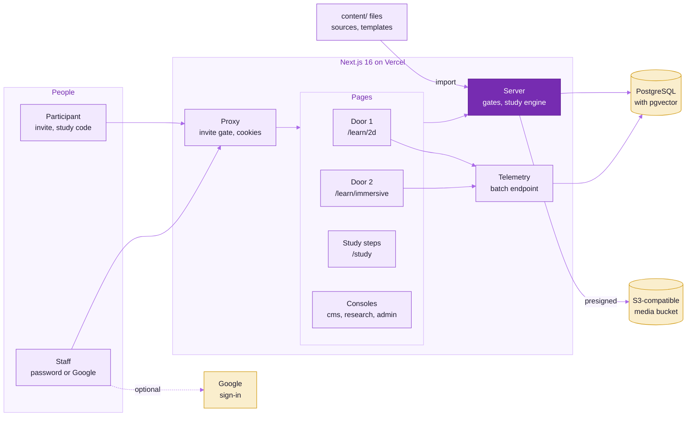

<picture>
  <source media="(prefers-color-scheme: dark)" srcset="docs/readme-kit/assets/hero-dark.svg">
  
</picture>

<p align="center">
  <picture>
    <source media="(prefers-color-scheme: dark)" srcset="https://readme-typing-svg.demolab.com?font=Plus+Jakarta+Sans&weight=600&size=20&duration=2800&pause=900&color=C090F5&center=true&vCenter=true&width=760&lines=Two+ways+to+learn+one+craft+process;A+visual+course%2C+or+a+walk+through+the+yards;One+stage+template%2C+every+caption+cited;Consent%2C+tests+and+a+delayed+test+in+one+engine">
    
  </picture>
</p>

<p align="center">
  
  
  
  
  
  <a href="https://github.com/cxacraftecosystem-ui/immersive-episteme/actions/workflows/ci.yml"></a>
</p>

**Immersive Episteme** is a research platform from IIT Kharagpur that compares two ways of learning how an Indian
hand-block-printed textile is made. Each participant learns one tradition through one of two doors: a visual course
(Door 1, `/learn/2d`) or a walk through its working yards in 3D (Door 2, `/learn/immersive`). Both doors are drawn
from the same stage template, so they carry the same cited captions, tools, materials and cloth, under the same time
limit. One knowledge model, study engine, telemetry pipeline and research console sit behind both.

<picture>
  <source media="(prefers-color-scheme: dark)" srcset="docs/readme-kit/assets/stats-dark.svg">
  
</picture>

<picture>
  <source media="(prefers-color-scheme: dark)" srcset="docs/readme-kit/assets/divider-dark.svg">
  
</picture>

## &nbsp; What it does

<picture>
  <source media="(prefers-color-scheme: dark)" srcset="docs/readme-kit/assets/cards-dark.svg">
  
</picture>

| Area | For | Where it lives | Read more |
|---|---|---|---|
| Door 1, the visual course | participants | `src/app/(learning)/learn/2d`, `src/features/course` | [Condition equivalence](docs/research/design-process/modules/condition-equivalence.md) |
| Door 2, the walk through the yards | participants | `src/app/(learning)/learn/immersive`, `src/features/walkthrough` | [Rendering quality](docs/architecture/immersive-rendering-quality.md) |
| Stage templates both doors read | both doors | `content/study/*.template.json`, `src/features/process` | [Content dataset](docs/research/content-dataset.md) |
| Study journey, consent, allocation, tests | participants, researchers | `src/app/(study)`, `src/server/study` | [Study engine](docs/research/design-process/modules/study-engine.md) |
| Knowledge model, sources, verification | curators | `db/schema/knowledge.ts`, `src/server/cms`, `/cms` | [Knowledge schema](docs/architecture/knowledge-schema.md) |
| Telemetry and the learning clock | both doors | `src/features/telemetry`, `src/server/telemetry`, `/api/telemetry/batch` | [Data and telemetry](docs/architecture/data-and-telemetry-layer.md) |
| Concept maps and scoring | researchers | `src/features/assessment`, `src/server/assessment` | [Concept-map scoring](docs/research/concept-map-scoring.md) |
| Dashboard, exports, statistics | researchers | `src/server/research`, `/research`, `analysis/episteme_stats` | [Research dashboard](docs/research/design-process/modules/research-dashboard.md) |
| People, invite codes, roles, audit | admins | `src/server/admin`, `src/server/access`, `/admin` | [Foundation](docs/architecture/foundation.md) |

## &nbsp; How it works

<picture>
  <source media="(prefers-color-scheme: dark)" srcset="docs/readme-kit/assets/pipeline-dark.svg">
  
</picture>

One Next.js 16 App Router application, a modular monolith, serves the public pages, both doors, the study steps, the
CMS, the research console and the admin, over one PostgreSQL database. Curated, source-cited content arrives from
`content/` and is imported under review; a curator accepts it on its recorded evidence, and a study pins one content
snapshot. A door opens only when every stage it teaches is verified in the database. Both doors send the same
telemetry in batches, which the research dashboard reads live.



### The study, step by step

A participant enters with an invite and a study code, consents to a versioned text whose SHA-256 is stored, and is
given one tradition, balanced across the study's traditions; a returning participant gets one they have not learned
yet. The door is drawn only after the blind steps and the device check, by default by permuted blocks within the
tradition and the pre-test stratum, so nothing before allocation can depend on it. This is the default order in
`src/server/study/config.ts`; a study may leave steps out, and `protocolIssues` refuses any order that breaks these
rules.

```mermaid
%%{init: {"theme":"base","fontFamily":"Inter, ui-sans-serif, system-ui, -apple-system, Segoe UI, Roboto, Helvetica, Arial, sans-serif","themeVariables":{"fontSize":"15px","primaryColor":"#F2E9FE","primaryTextColor":"#1E1B2E","primaryBorderColor":"#9148D2","secondaryColor":"#FAEECD","secondaryTextColor":"#1E1B2E","secondaryBorderColor":"#CD9200","tertiaryColor":"#F3F1FA","tertiaryTextColor":"#1E1B2E","tertiaryBorderColor":"#A7A3BC","mainBkg":"#F2E9FE","nodeBorder":"#9148D2","nodeTextColor":"#1E1B2E","lineColor":"#AA69E9","textColor":"#857F9E","edgeLabelBackground":"#F9F5FF","clusterBkg":"#F9F5FF","clusterBorder":"#D6B6FB","titleColor":"#762CB1","noteBkgColor":"#FAEECD","noteTextColor":"#1E1B2E","noteBorderColor":"#CD9200","actorBkg":"#F2E9FE","actorBorder":"#9148D2","actorTextColor":"#1E1B2E","actorLineColor":"#AA69E9","signalColor":"#AA69E9","signalTextColor":"#857F9E","labelBoxBkgColor":"#F2E9FE","labelBoxBorderColor":"#9148D2","labelTextColor":"#1E1B2E","loopTextColor":"#857F9E","activationBkgColor":"#E7D5FE","activationBorderColor":"#9148D2","sequenceNumberColor":"#FFFFFF","transitionColor":"#AA69E9","transitionLabelColor":"#857F9E","stateLabelColor":"#1E1B2E","stateBkg":"#F2E9FE","compositeBackground":"#F9F5FF","compositeTitleBackground":"#F2E9FE","attributeBackgroundColorOdd":"#FFFFFF","attributeBackgroundColorEven":"#F9F5FF","relationColor":"#AA69E9","relationLabelBackground":"#F9F5FF","relationLabelColor":"#1E1B2E"}}}%%
flowchart TD
  EN(["Invite and study code"]) --> CS["Consent<br/>one tradition given"]
  subgraph Blind["Before the door is known"]
    QP["Questions before<br/>you start"]
    PT["Pre-test"]
    DC["Device check"]
  end
  CS --> QP --> PT --> DC --> AL{"Allocation<br/>Door 1 or Door 2"}
  subgraph Door["In the allocated door"]
    FA["Practice with<br/>the controls"]
    ON["Introduction to<br/>the task"]
    LE["Learning<br/>timed, capped"]
  end
  AL --> FA --> ON --> LE
  subgraph After["After learning"]
    QL["Questions about<br/>the task"]
    PO["Post-test"]
    TR["Transfer task"]
    RC["Concept map"]
    LS["Layout sketch"]
    QE["Final questionnaire"]
  end
  LE --> QL --> PO --> TR --> RC --> LS --> QE
  QE --> DT(["Delayed test<br/>in its window"])
  classDef accent fill:#762CB1,stroke:#5F1C93,color:#FFFFFF
  class LE accent
```



| Rule | Where it is enforced |
|---|---|
| Learning ends only at the finish or the time cap; the clock starts when the door first loads | `src/server/learning/context-data.ts`, migrations `0008`, `0009`, `0022` |
| A door refuses to open if any stage it teaches is not verified | `requireVerifiedStages` in `src/server/learning/context-data.ts` |
| Telemetry is append-only; demo data never enters a real study; published snapshots are immutable | database triggers, from `db/migrations/0003_integrity_triggers.sql` on |
| Staff previews and the public demo are flagged non-experimental | `src/server/auth/learning-decision.ts` |
| Participants are pseudonymous: no account, a signed cookie checked against the database on every request | `src/server/auth/participant-session.ts`, `study-session-lookup.ts` |

### Who may do what

| Role | Stored as | Can |
|---|---|---|
| Super Admin | `super_admin` | everything, including settings, the audit log, roles, and making people Admin or Super Admin; the last active Super Admin cannot be demoted or locked |
| Admin | `platform_admin` | lets people in: gives waiting accounts the Researcher or Curator role, locks accounts, resets passwords, makes invite codes |
| Researcher | `researcher` | runs studies: sets them up, invites participants, watches sessions, scores and exports |
| Principal investigator | a Researcher with the `principal_investigator` mark | also activates studies, excludes sessions, removes participant data, makes identified exports, reads the audit log, and verifies and publishes content |
| Curator | `curator` | looks after the content: writes, reviews, verifies and publishes it; nobody verifies an item they wrote or edited |
| Participant, public visitor | never stored | a participant session cookie, or no credential at all |

The single source of truth is `src/lib/permissions/matrix.ts`, with the roles in `src/lib/permissions/roles.ts`. An
account whose verified email is listed in `SUPER_ADMIN_EMAILS` becomes Super Admin when it signs in. Every console page
runs its own permission check, because Next 16 streams a page's payload even when its layout refuses it.

## &nbsp; Built with

<p align="center">
  <picture>
    <source media="(prefers-color-scheme: dark)" srcset="https://skillicons.dev/icons?i=nextjs,react,ts,threejs,tailwind,nodejs,postgres,supabase,docker,vitest,py,githubactions,vercel&theme=dark&perline=13">
    
  </picture>
</p>

| Layer | Stack |
|---|---|
| App | Next.js 16.4 (App Router, `cacheComponents`, `src/proxy.ts`), React 19.3, TanStack Query 5, Zod 4, Tailwind 4 with shadcn and Radix |
| Door 2 | Three.js r186 (`three` 0.186.1) |
| Data | PostgreSQL 18 with pgvector, pg_trgm and pgcrypto locally (17 is accepted too), Drizzle ORM 0.45 and drizzle-kit, `pg` |
| Auth | Better Auth 1.7: email and password, optional Google, database-backed rate limits |
| Consoles | Tiptap 3 for text, React Flow (`@xyflow/react`) for concept maps and the CMS graph, ECharts 6 for the dashboard |
| Media | the AWS SDK v3 S3 client against any S3-compatible bucket, or a local folder |
| Tooling | Node.js 24, TypeScript 5.9, ESLint 10, Vitest 5, Playwright 1.64; Python for `analysis/episteme_stats` |

Every version is pinned exactly in `package.json`; the reasons are in
[ADR 0001](docs/decisions/0001-stack-and-foundation.md).

## &nbsp; Quick start

You need Node.js 24 (`.nvmrc`), npm 11 and Docker Desktop. PostgreSQL 18 with pgvector runs in Docker on
`localhost:5433`.

1. Install the dependencies and make your environment file, then set `BETTER_AUTH_SECRET` with the generator
   command written in it.

   ```bash
   npm ci
   cp .env.example .env
   ```

2. Start and migrate the databases (`episteme`, and `episteme_test` for the tests), then create the first staff
   account, a Super Admin. The password is read from `ADMIN_PASSWORD` (at least 12 characters).

   ```bash
   npm run db:up
   npm run db:migrate
   npm run db:migrate -- --test
   ADMIN_PASSWORD='choose-a-long-password' npm run create-admin -- --email admin@example.org --name "Local Admin"
   ```

3. Load the development data: reference and demo data, the content in `content/`, a review snapshot and a draft demo
   study pinned to it. `--verify-as` accepts, as that account, everything the content files record as verified, so
   the doors have content to show; it needs an account that may verify (a Curator, the principal investigator or the
   Super Admin). The script refuses any database that is not local.

   ```bash
   npm run dev:bootstrap -- --verify-as admin@example.org
   ```

4. Start the app and sign in at `http://localhost:3000/sign-in`. Sign-in must come from the origin in
   `BETTER_AUTH_URL`.

   ```bash
   npm run dev
   ```

5. Before pushing, run what CI runs.

   ```bash
   npm run check          # typecheck, lint, unit and integration tests
   npm run build
   npm run test:e2e       # Playwright; starts next dev on :3000
   ```

Every script, the migrations, the test projects and the source layout are in
[docs/development.md](docs/development.md).

<picture>
  <source media="(prefers-color-scheme: dark)" srcset="docs/readme-kit/assets/divider-dark.svg">
  
</picture>

## &nbsp; The content rule

Never fabricate craft facts. Curated, source-cited content lives in `content/`, maintained by a separate curation
effort, in the format of `content/FORMAT.md`. In a file, `verified` means the item passed a mechanical source check
recorded in `content/review/<tradition>-verification.md`: every quote was found again, word for word, at its locator
in an archived copy of a recorded source. It is still imported as `under_review`; acceptance in the database is a
named curator's transition, in the CMS or through `scripts/content/verify-concepts.ts`, which accepts a file's
tradition, sources, concepts and links under the same evidence rule (DR-059, DR-120, DR-124, DR-133). Fixtures and
demo data are flagged `is_demo = true`, titled `Demo: …`, and can never be published into a study; database triggers
enforce it.

## &nbsp; CI

| Workflow | Runs on | Does |
|---|---|---|
| `ci.yml`, Typecheck, lint, test, build | every push to `main`, pull requests | migrations on a PostgreSQL 18 + pgvector service, `typecheck`, `lint`, unit and integration tests, `build` |
| `ci.yml`, Content dataset contract | every push to `main`, pull requests | `npm run test:content` against `content/FORMAT.md`, reported apart so it never gates the application jobs |
| `ci.yml`, Playwright smoke | after the first job | bootstraps the database with the real content and the demo study, then the end-to-end specs |
| `ci.yml`, Interface parity and design acceptance | after the first job | the alignment checks between the two doors |
| `readme-check.yml` | a change to the README, `docs/`, `.claude/skills/` or the kit | kit assets match `kit.json`, SVG rules, xmllint, image budgets, every mermaid block renders in mermaid-cli and on github.com, GitHub renders the Markdown |

## &nbsp; Documentation

| Question | Read |
|---|---|
| Where is everything? | [docs/README.md](docs/README.md), the index |
| What binds every change, and how should screens look? | [DESIGN.md](DESIGN.md), [AGENTS.md](AGENTS.md) |
| Which stack, and why? | [ADR 0001](docs/decisions/0001-stack-and-foundation.md), [ADR 0002](docs/decisions/0002-feature-dependencies.md), [ADR 0003](docs/decisions/0003-visual-system.md) |
| How do I run, test and migrate it locally? | [docs/development.md](docs/development.md) |
| How are routes, permissions and participant sessions built? | [foundation.md](docs/architecture/foundation.md) |
| What is stored, and which invariants does the database enforce? | [knowledge-schema.md](docs/architecture/knowledge-schema.md) |
| How is content validated and snapshotted? | [knowledge-graph-validation.md](docs/architecture/knowledge-graph-validation.md) |
| How do pages get their context, and how does telemetry flow? | [data-and-telemetry-layer.md](docs/architecture/data-and-telemetry-layer.md) |
| What must Door 2 meet, and what was measured? | [immersive-rendering-quality.md](docs/architecture/immersive-rendering-quality.md), [immersive-rendering-results.md](docs/architecture/immersive-rendering-results.md) |
| What do the content files hold? | [content/FORMAT.md](content/FORMAT.md), [content-dataset.md](docs/research/content-dataset.md), [citation-policy.md](docs/research/citation-policy.md) |
| Which study parameters were chosen, and from which papers? | [study-decisions.md](docs/research/study-decisions.md), [requirements-digest.md](docs/research/requirements-digest.md) |
| How are concept maps scored? | [concept-map-scoring.md](docs/research/concept-map-scoring.md) |
| Why is it built the way it is? | [Decision records DR-001 on](docs/research/design-process/decisions.md), [the design process record](docs/research/design-process/README.md) |
| How do I deploy it? | [docs/deploy/RUNBOOK.md](docs/deploy/RUNBOOK.md), with the vendor research in [RESEARCH.md](docs/deploy/RESEARCH.md) |
| Where does every image come from? | [docs/image-credits.md](docs/image-credits.md), generated |
| How is this README built? | [docs/readme-kit/README_STYLE.md](docs/readme-kit/README_STYLE.md) |

## &nbsp; Status

<picture>
  <source media="(prefers-color-scheme: dark)" srcset="docs/readme-kit/assets/timeline-dark.svg">
  
</picture>

The site is at [immersive-episteme.vercel.app](https://immersive-episteme.vercel.app), behind its invite gate. The
latest deploy runs the functions in Vercel `bom1` (Mumbai) on Supabase PostgreSQL 17 in Mumbai, which the migrations
and the version check accept since commit `9b23139`. The deployment runbook still describes the two options it was
written for, Amazon RDS and S3 in Mumbai or Neon and Cloudflare R2 in Singapore, and the data-location check against
the CXA/ETH/01 ethics protocol that comes before any real participant data.

<picture>
  <source media="(prefers-color-scheme: dark)" srcset="docs/readme-kit/assets/footer-dark.svg">
  
</picture>
