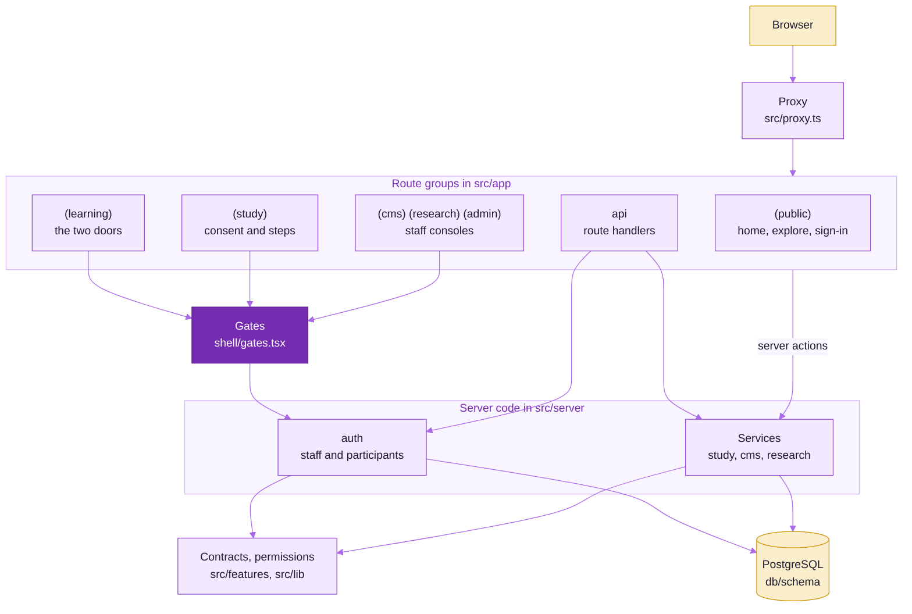
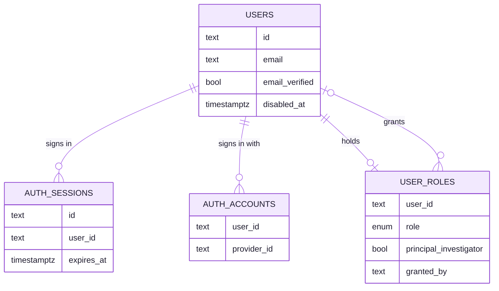
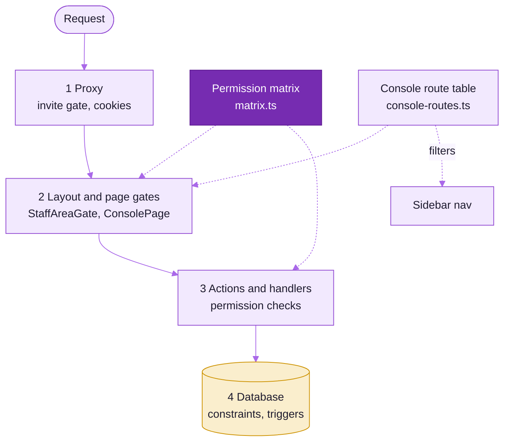
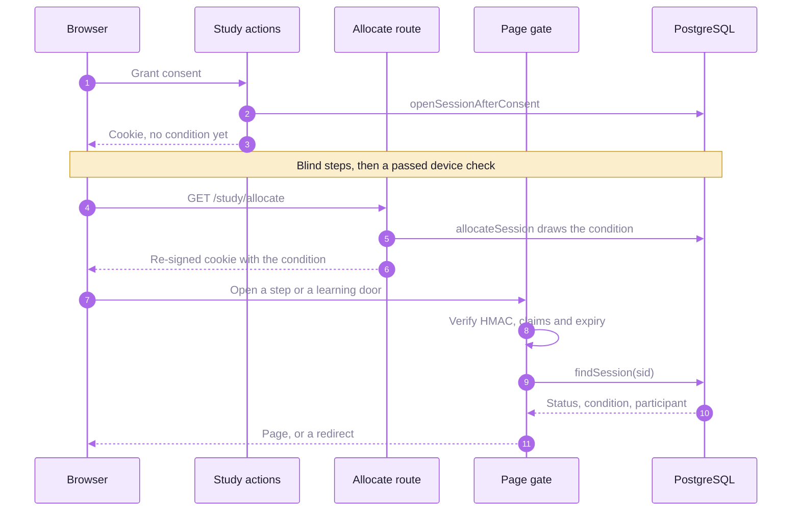
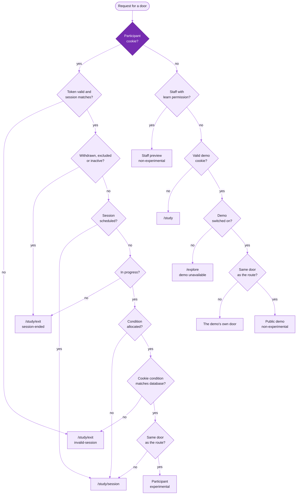

<picture>
  <source media="(prefers-color-scheme: dark)" srcset="../readme-kit/assets/divider-dark.svg">
  
</picture>

# &nbsp; Foundation: structure, permission model, participant sessions

Status: current as of 2026-10-14. Companion to `docs/decisions/0001-stack-and-foundation.md`
(stack, versions) and `docs/architecture/knowledge-schema.md` (data model).

## 1. Structure

One Next.js 16 App Router application (modular monolith) over one PostgreSQL 18 database.

How a request passes through the parts listed in the table:



| Area | Location | Notes |
|---|---|---|
| Public pages | `src/app/(public)/` | `/`, `/about`, `/privacy`, `/accessibility`, `/explore` (public demo entry), `/sign-in`, `/sign-out`, `/forbidden` |
| Learning conditions | `src/app/(learning)/learn/{2d,immersive}/` | The two experimental conditions. Guarded per page |
| Study flow | `src/app/(study)/study/` | `/study`, `/study/consent`, `/study/complete` are open; `(session)/*` steps (pre-test, task, post-test, questionnaire, reconstruction, session) need a participant session |
| CMS | `src/app/(cms)/cms/` | Content, graph, sources, media, review queue, dataset versions, spatial compiler |
| Research console | `src/app/(research)/research/` | Studies, participants, sessions, assessments, scoring, analytics, exports, parity |
| Admin | `src/app/(admin)/admin/` | People, invite codes, settings, roles, audit |
| Auth API | `src/app/api/auth/[...all]/route.ts` | Better Auth handler (`/api/auth/ok` is its health check) |
| Proxy | `src/proxy.ts` | Next 16 name for middleware. The site's invite gate, otherwise cheap cookie-presence redirects only |
| Shells and gates | `src/components/shell/` | Layout shells, `gates.tsx` (server-side access gates) |
| Feature modules | `src/features/*/contracts.ts` | Zod contracts per domain (knowledge, spatial, study, telemetry, cms, media, research) |
| Server code | `src/server/{auth,db}` | `getDb()` in `src/server/db/client.ts`; env via `serverEnv()` in `src/lib/env.ts` |
| Permissions | `src/lib/permissions/` | Role catalogue, permission list, matrix, `can`, console route table |
| Schema | `db/schema/*.ts` | 65 tables: auth (7), knowledge (12), publishing (2), media (5), spatial (5), study (11), assessment (12), telemetry (7), release (2), access (1), audit (1) |
| Migrations | `db/migrations/0000..0031` | Extensions, helper functions, tables (drizzle-kit), integrity triggers, then later changes |
| Seeds | `db/seeds/` | Reference data and demo data (`is_demo = true`, `Demo:` titles) |

`cacheComponents` is on. Anything that reads cookies, headers or the session renders inside
`<Suspense>`, so most guarded routes build as Partial Prerender (static shell + streamed,
guarded content).

### Staff accounts and the domain tables

Better Auth owns `users`, `auth_sessions`, `auth_accounts`, `auth_verifications` and
`auth_rate_limits` (`db/schema/auth.ts`); `user_roles` stores one row per user (its staff role
and principal-investigator mark).
Domain tables reference `users.id` through the actor helpers in `db/schema/_common.ts`
(38 foreign keys): optional actors are `ON DELETE SET NULL`, required ones `ON DELETE
RESTRICT`. Staff accounts are therefore never hard-deleted; an administrator locks one with
`users.disabled_at`, and a Better Auth session-create hook refuses locked users.
`audit_log.actor_id` is plain text on purpose, since actors include the system and participants.

Participants are not users. They have no row in `users` and never appear in actor columns.

The staff account tables and their keys:



## 2. Permission model

Single source of truth: `src/lib/permissions/matrix.ts` (9 roles x 33 permissions). Every
cell is asserted in `tests/unit/permissions.test.ts` against an independently written table.

Roles (`src/lib/permissions/roles.ts`):

- Staff (stored in `user_roles`, one row per person, DR-133, DR-134): `super_admin`,
  `platform_admin` (shown as Admin), `researcher` (with an optional principal-investigator
  mark, granted as `principal_investigator`) and `curator`.
- Synthesised, never stored: `participant` (from a valid participant-session cookie) and
  `public` (no credential).

Policy rules encoded in the matrix:

- `super_admin` holds every staff permission: settings, roles, the audit log and making people
  Admin or Super Admin are its alone. The last active Super Admin cannot be demoted, locked or
  removed; an account whose verified email is in `SUPER_ADMIN_EMAILS` becomes Super Admin when
  it signs in.
- `platform_admin` only lets people in: it sees the people, gives and removes the Researcher or
  Curator role, locks, unlocks and resets the passwords of Researchers and Curators, and makes
  and revokes invite codes.
- Verification and publication belong to curators, the principal investigator and the Super
  Admin; nobody verifies an item they wrote or edited.
- Only the principal investigator and the Super Admin activate studies, exclude sessions,
  remove participant data and create identified exports.
- Every staff role may preview both learning conditions; such access is always flagged
  non-experimental.

Enforcement layers:

1. Proxy (`src/proxy.ts`): outside the staff consoles and the exempt pages
   (`src/lib/access/invite-paths.ts`) it admits a request only with a live invite cookie
   (`ie_invite`) or a staff session, since the site is invite-only. Beyond that it only checks
   that the relevant cookie is present and redirects early
   (`/cms`, `/research`, `/admin` to `/sign-in?next=…`; `/learn/*` and `/study/<step>` to
   `/study`). It never checks a permission. It also sends
   `X-Frame-Options: DENY` / `frame-ancestors 'none'` on the sign-in surfaces and its own
   redirects.
2. Layout and page gates (`src/components/shell/gates.tsx`): `StaffAreaGate` on each console
   layout, and `ConsolePage` on each console page, enforcing the permission from the route
   table in `src/lib/permissions/console-routes.ts`. The same table filters the sidebar, so
   the nav cannot show a link the page would refuse. Learning and in-session study pages use
   `LearningPage` / `ParticipantPage`.
3. Server actions and route handlers: `requirePermission`, `authorizeRequest`,
   `assertPermission` (`src/server/auth/staff.ts`, `src/lib/permissions/can.ts`).
4. Database: constraints and triggers (`0003_integrity_triggers.sql`) for invariants that must
   hold whatever the caller: immutable published snapshots, append-only telemetry, demo data
   never in a real study, study activation preconditions.

The four layers in the order a request meets them, and the tables that drive layers 2 and 3:



Why every page checks, not just the layout: Next 16 renders a layout and its page in parallel
and streams the page's payload even when the layout refuses to render it. Gating only in the
layout leaked the page's content in the response body. Every protected page therefore runs its
own guard before producing markup. A refused request still carries the page's static
`metadata` title, so titles must never contain protected data.

Staff authentication: Better Auth email + password, sign-up disabled, minimum password
length 12, database-backed rate limit (5 sign-in attempts per minute per IP), httpOnly
SameSite=Lax cookies with prefix `ie` (Secure and `__Secure-` in production). The first
account is created with `npm run create-admin`.

## 3. Participant-session model

Participants never get a Better Auth account. A participant's identity during a sitting is a
pseudonymous participant id, a study session id and the assigned condition, carried in a
signed cookie:

- Cookie: `ie_study_session` (`__Host-ie_study_session` in production), httpOnly,
  SameSite=Lax, path `/`, maximum age 6 hours.
- Token (`src/server/auth/participant-session-token.ts`): HMAC-SHA256 over strict claims
  `{ t: "participant", pid, sid, cond, iat, exp }`, with a key derived from
  `BETTER_AUTH_SECRET` for the purpose `participant-session/v1` only. The public-demo cookie
  (`ie_demo`) uses a different purpose key, so one can never pass as the other. Ids must be
  opaque (`[A-Za-z0-9_-]`); emails and names are rejected.
- Issuing: `issueParticipantSessionCookie()` (`src/server/auth/participant-session.ts`), called
  by the study Server Actions (`src/server/study/actions.ts`) once consent has opened the
  `study_sessions` row, before any condition is drawn (`cond` is `null`); `/study/allocate`
  signs a new cookie with the condition once `allocateSession` has drawn it.

The cookie alone is never trusted. Every check also asks the database through the
`StudySessionLookup` port (`study-session-port.ts`), whose default implementation
(`study-session-lookup.ts`) joins `study_sessions`, `study_conditions` (assigned interface:
`conventional_2d` to `2d`, `immersive_3d` to `immersive`) and `participants`. A
reassignment, withdrawal or exclusion therefore takes effect on the next request.

How the cookie is issued, re-signed after allocation, and checked on every guarded page:



Learning access (`src/server/auth/learning-decision.ts`) is granted in exactly three ways:

| Route | Who | Result |
|---|---|---|
| `/learn/<cond>` | Participant: valid cookie, cookie condition = route condition = database condition, session `in_progress`, not withdrawn, participant `enrolled` or `active` | Allowed, `experimental: true` |
| `/learn/<cond>` | Public demo: valid `ie_demo` cookie set via `/explore` | Allowed, `experimental: false` |
| `/learn/<cond>` | Signed-in staff holding `learn.<cond>` | Allowed (preview), `experimental: false` |

A participant cookie, when present, always decides, even if the browser also holds a demo or
staff cookie. This keeps a participant from reaching the other condition through `/explore`
or a shared lab machine. Refusals redirect to:

| Reason | Redirect |
|---|---|
| No credential at all | `/study` |
| Cookie for the other condition | `/study/session` |
| Tampered, expired or unknown session | `/study/exit?reason=invalid-session` |
| Session not started (`scheduled`) | `/study/session` |
| Session ended, withdrawn, participant inactive | `/study/exit?reason=session-ended` |

The whole decision, in the order `resolveLearningAccess` checks it:



In-session study steps (`/study/(session)/*`) require a valid participant cookie and a
session that is not completed, abandoned or withdrawn, for an active participant.

The default journey is `DEFAULT_STEPS` (`src/server/study/config.ts`); a study may leave steps
out but keeps the order `protocolIssues` enforces. Code entry enrols the participant
(`enrolled`), consent opens the session `in_progress` with its tradition and makes the
participant `active` (`openSessionAfterConsent`), `allocateSession` draws the condition only
after the blind steps (`questionnaire_pre`, `pre_test`) and a passed device check, and after
`questionnaire_post_learning`, `post_test`, `transfer`, `reconstruction`, `layout_sketch` and
`questionnaire_end` the `delayed_test` opens days later through `/study/return`; finishing
marks session and participant `completed`.

```mermaid
%%{init: {"theme":"base","fontFamily":"Inter, ui-sans-serif, system-ui, -apple-system, Segoe UI, Roboto, Helvetica, Arial, sans-serif","themeVariables":{"fontSize":"15px","primaryColor":"#F2E9FE","primaryTextColor":"#1E1B2E","primaryBorderColor":"#9148D2","secondaryColor":"#FAEECD","secondaryTextColor":"#1E1B2E","secondaryBorderColor":"#CD9200","tertiaryColor":"#F3F1FA","tertiaryTextColor":"#1E1B2E","tertiaryBorderColor":"#A7A3BC","mainBkg":"#F2E9FE","nodeBorder":"#9148D2","nodeTextColor":"#1E1B2E","lineColor":"#AA69E9","textColor":"#857F9E","edgeLabelBackground":"#F9F5FF","clusterBkg":"#F9F5FF","clusterBorder":"#D6B6FB","titleColor":"#762CB1","noteBkgColor":"#FAEECD","noteTextColor":"#1E1B2E","noteBorderColor":"#CD9200","actorBkg":"#F2E9FE","actorBorder":"#9148D2","actorTextColor":"#1E1B2E","actorLineColor":"#AA69E9","signalColor":"#AA69E9","signalTextColor":"#857F9E","labelBoxBkgColor":"#F2E9FE","labelBoxBorderColor":"#9148D2","labelTextColor":"#1E1B2E","loopTextColor":"#857F9E","activationBkgColor":"#E7D5FE","activationBorderColor":"#9148D2","sequenceNumberColor":"#FFFFFF","transitionColor":"#AA69E9","transitionLabelColor":"#857F9E","stateLabelColor":"#1E1B2E","stateBkg":"#F2E9FE","compositeBackground":"#F9F5FF","compositeTitleBackground":"#F2E9FE","attributeBackgroundColorOdd":"#FFFFFF","attributeBackgroundColorEven":"#F9F5FF","relationColor":"#AA69E9","relationLabelBackground":"#F9F5FF","relationLabelColor":"#1E1B2E"}}}%%
flowchart LR
  E["Study code<br/>/study"] --> C{"Consent?"}
  C -->|declined| X["Declined<br/>/study/complete"]
  C -->|granted| BL["Blind steps<br/>questionnaire, pre-test"]
  BL --> D["Device check"]
  D -->|passed| AL["Allocation<br/>/study/allocate"]
  AL --> L["Familiarisation,<br/>onboarding, learning"]
  L --> PL["After learning<br/>tests, map, sketch"]
  PL -->|days later| DT["Delayed test"]
  DT --> F["Completed<br/>/study/complete"]
  classDef accent fill:#762CB1,stroke:#5F1C93,color:#FFFFFF
  class AL accent
```



Because guarded pages stream (Partial Prerender), a refusal after the proxy has passed the
request (for example a forged cookie) arrives as HTTP 200 whose body contains only the
redirect instruction (`NEXT_REDIRECT` plus a meta refresh), not the page content. A request
with no cookie at all is redirected by the proxy with a real 307.

## 4. Verification commands

```bash
npm run db:reset && npm run db:reset -- --test && npm run db:seed
npm run typecheck && npm run lint && npm test && npm run build && npm run test:e2e
```

Relevant tests: `tests/unit/permissions.test.ts` (matrix), `tests/integration/auth-guards.test.ts`
(learning and step guards, tampered cookies, the Drizzle lookup against `episteme_test`),
`tests/integration/auth-staff.test.ts` (Better Auth, roles, rate limit), and
`tests/integration/schema-*.test.ts` (constraints, publishing, telemetry, seed, content format).
