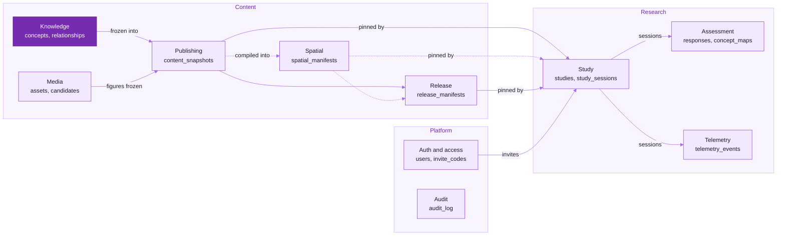
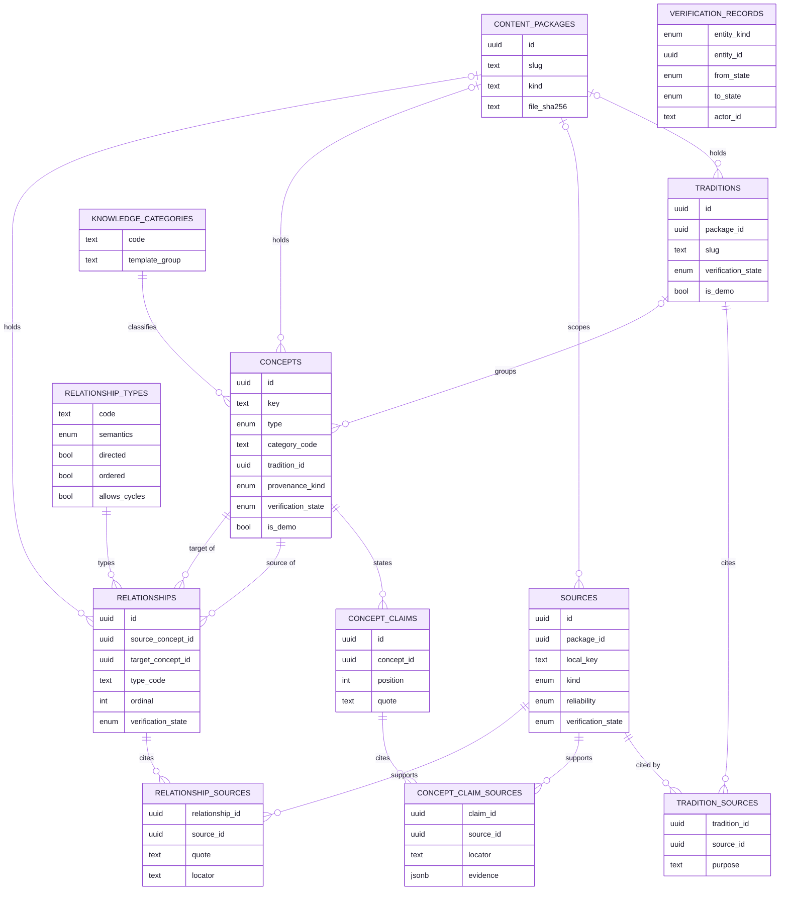
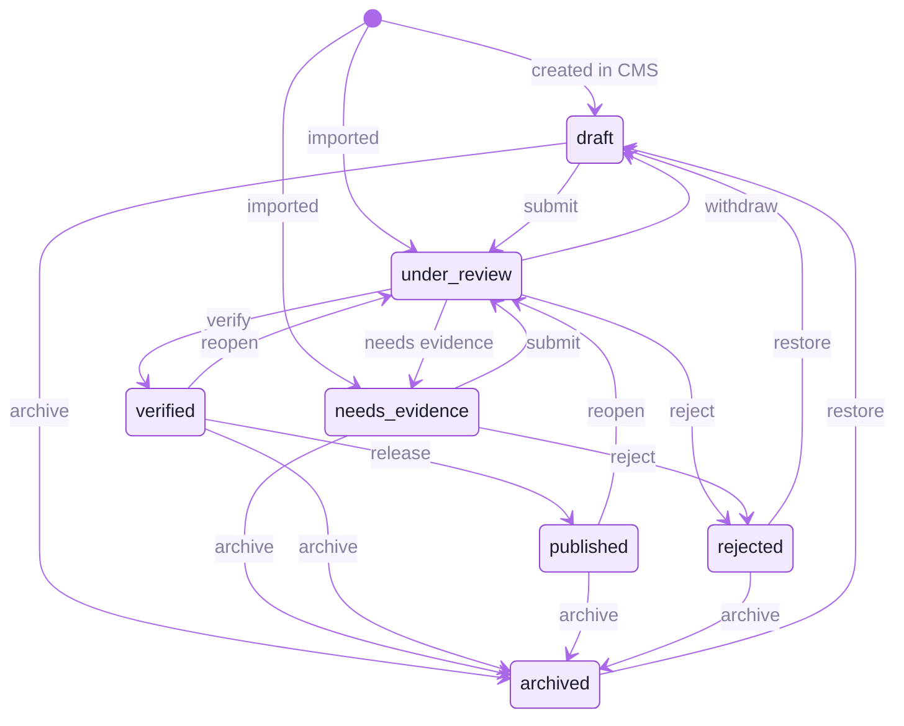
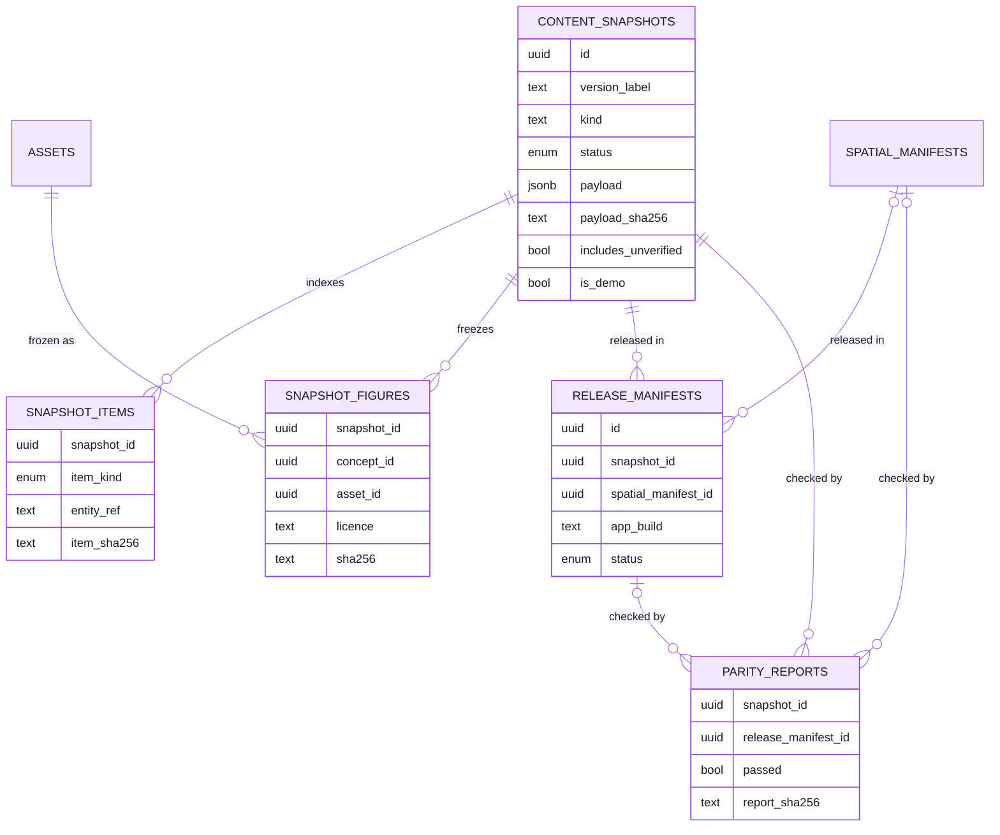
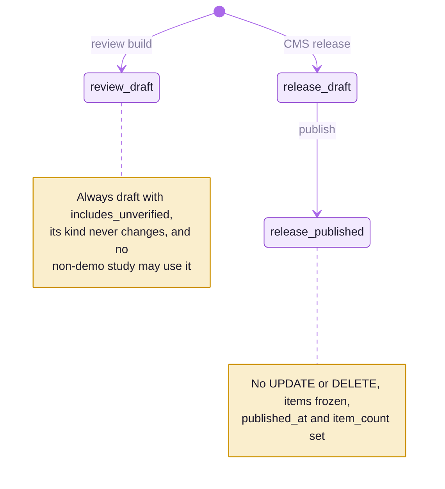
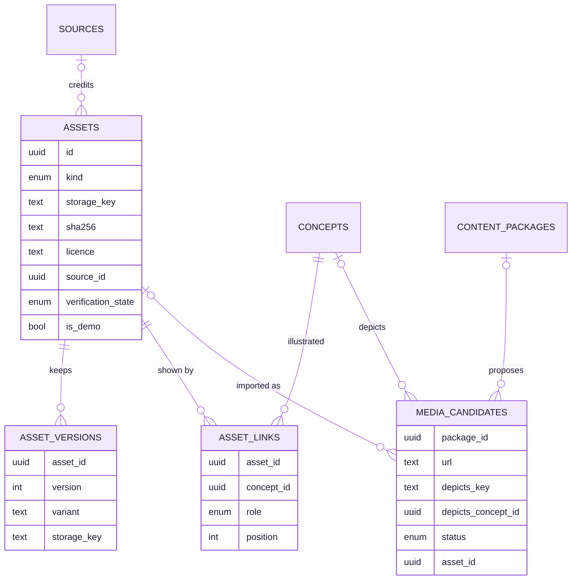
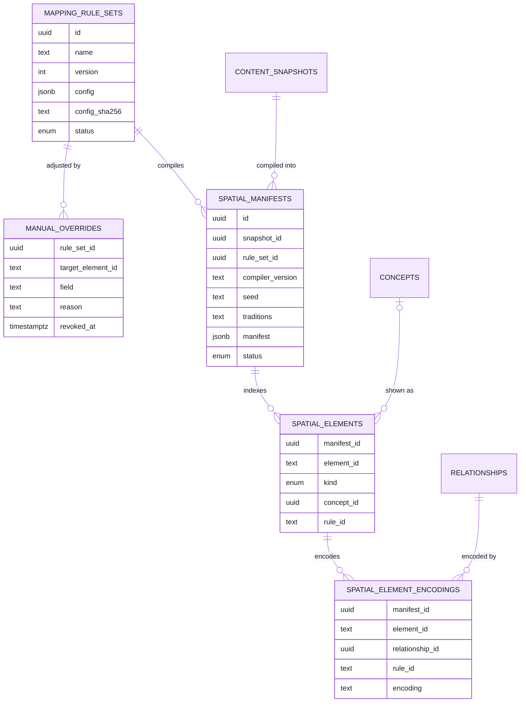
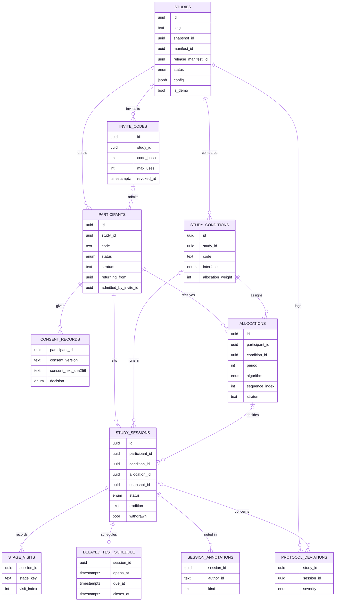
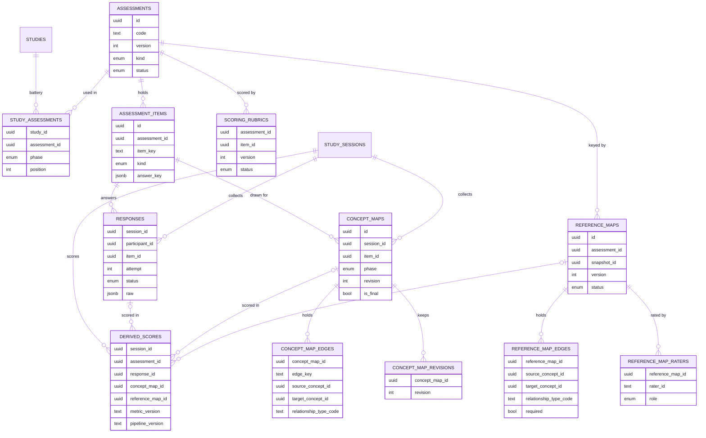
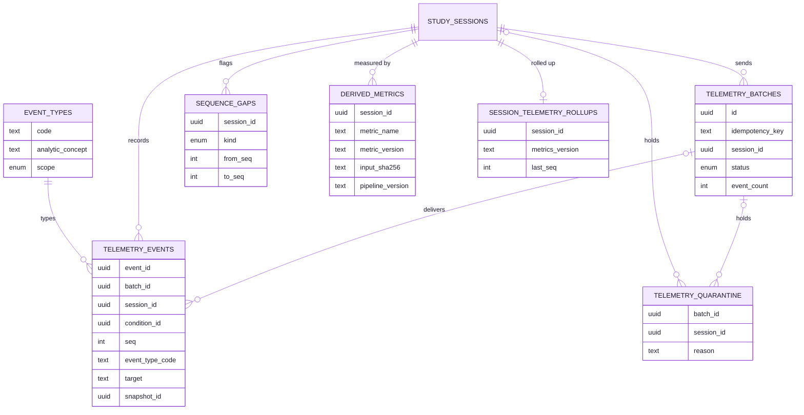

<picture>
  <source media="(prefers-color-scheme: dark)" srcset="../readme-kit/assets/divider-dark.svg">
  
</picture>

# &nbsp; Knowledge and research data schema

- **Status:** implemented (migrations `0000`–`0003`)
- **Code:** `db/schema/*.ts` (Drizzle), `db/migrations/*.sql`, `src/features/*/contracts.ts` (Zod),
  `src/lib/validation/{enums,primitives}.ts`
- **Tests:** `tests/integration/schema-*.test.ts`

One PostgreSQL 18 database holds the typed craft-knowledge graph, publishing, media, spatial
compilation, studies, assessments, telemetry and audit. Both learning conditions read the same
published snapshot, so content parity follows from the data model rather than from discipline.

## Conventions

| Topic | Rule |
|---|---|
| Keys | `uuid` primary keys defaulting to PostgreSQL 18 `uuidv7()` (time-ordered). Reference tables use natural codes (`knowledge_categories.code`, `relationship_types.code`, `event_types.code`). |
| Names | snake_case columns (Drizzle `casing: "snake_case"`); TypeScript keys are camelCase. |
| Time | `timestamptz` everywhere. |
| Vocabularies | Postgres enums built from the const tuples in `src/lib/validation/enums.ts`, which Zod contracts reuse. Changing a value needs a migration. |
| Actors | Staff actor columns (`created_by`, `published_by`, ...) are FKs to Better Auth `users.id` (text, `db/schema/auth.ts`). Never cascade. Participants are never users. |
| Hashes | `*_sha256` columns are lowercase hex. Snapshot payloads, manifests, rule-set configs and parity reports hash themselves through a generated column, `ie_jsonb_sha256(jsonb)`, so a hash can never drift from its document. jsonb normalises key order, so equal documents hash equally. |
| Errors | Trigger violations raise SQLSTATE `23514` with a message that starts with `ie: `. |
| Search | `concepts.search` is a stored `tsvector` (title and local terms weight A, summary B, body C, `simple` configuration so transliterated craft terms are not stemmed) with a GIN index. `concepts.title` and `sources.title` have GIN trigram indexes. |

### Migrations

| File | Kind | Content |
|---|---|---|
| `0000_enable_extensions` | custom | `pg_trgm`, `vector`, `pgcrypto` |
| `0001_helper_functions` | custom | `ie_jsonb_sha256`, `ie_concept_search_vector` (IMMUTABLE, needed by generated columns), `ie_raise` |
| `0002_domain_tables` | drizzle-kit | every table, enum, FK, unique, check and index |
| `0003_integrity_triggers` | custom | the invariants listed below |

`npm run db:generate` after editing `db/schema/*.ts`. Custom SQL goes in a file created by
`npx drizzle-kit generate --custom --name <name>`. `db/schema/auth.ts` (Better Auth) is part of
the same migration chain.

## Domains

The domains and the links between them; each domain's tables are drawn under its heading below. The
spatial links are dotted: the tables remain and a study may still pin a manifest, but the compiler that wrote them
was removed with the old doors (DR-076), and no door reads a manifest.



### Knowledge

The knowledge tables and their keys (`db/schema/knowledge.ts`):



- **Concepts** are one table with a `type` (13 values: tradition, material, tool, process_stage,
  artisan_decision, design_principle, outcome, scientific_mechanism, environmental_condition,
  comparison, explanation, historical_context, open_question) and a `category_code` (14
  categories). Material, tool, process step and the rest are concept types, not tables (spec
  §6.3 allows this). Each concept carries `provenance_kind` (practitioner_testimony,
  historical_documentation, scientific_evidence, researcher_interpretation, hypothesis,
  unverified) and `verification_state` (draft, under_review, verified, published, rejected,
  needs_evidence, archived).
- `key` is the stable interchange id `<namespace>.<type>.<kebab-name>`; the type segment must
  equal `type`. `slug` is derived as `slugFromConceptKey(key)` (dots and underscores become dashes).
- `body` is a Tiptap/ProseMirror JSON document (CMS-authored); `body_md` keeps imported markdown.
- **Claims** are the sourced statements of a concept; each claim cites one or more sources
  (`concept_claim_sources`, with an optional `locator`). Quotes are limited to 25 words.
- **Relationships** connect two concepts with a registry type, `explanation`, `conditions`, an
  optional `strength` in [0, 1], an `ordinal` for ordered sequences, their own provenance and
  review state, and sources (`relationship_sources`, with optional quote and locator).
- **Relationship types** form a registry with a `semantics` class, so causal, sequential,
  associative, compositional, explanatory and comparative links are never collapsed:

| Code | Semantics | Directed | Cycles | Ordered |
|---|---|---|---|---|
| BELONGS_TO | compositional | yes | **no** | no |
| USES, REQUIRES | compositional | yes | yes | no |
| PRECEDES | sequential | yes | yes (see note) | **yes** |
| DEPENDS_ON | sequential | yes | **no** | no |
| PRODUCES, CAUSES, ENABLES, AFFECTED_BY | causal | yes | yes | no |
| EXPLAINS, PRACTITIONER_EXPLAINS, SCIENTIFICALLY_EXPLAINED_BY | explanatory | yes | yes | no |
| SIMILAR_TO, CONTRASTS_WITH | comparative | **no** | yes | no |
| ASSOCIATED_WITH (not in FORMAT v1) | associative | **no** | yes | no |

  Every type `requires_evidence`. PRECEDES allows cycles because the curated Dabu process has a
  real repeat loop (the "repeat cycles" stage returns to resist printing), so the spatial
  compiler must handle sequence loops. Researchers can add types to the registry without a
  migration.
- **Content packages** record which interchange file (or CMS collection) a row came from. They
  scope file-local source ids (`sources.local_key`, unique per package) so re-imports are
  idempotent.
- **verification_records** is the append-only review history, written by trigger on every state
  change of traditions, concepts, relationships, sources and assets.

The CMS moves an item only along these transitions (`VERIFICATION_TRANSITIONS` in
`src/features/knowledge/contracts.ts`, labelled with the names `classifyTransition` gives them
in `src/server/cms/workflow.ts`); `published` is reached only through a release:



### Publishing

`content_snapshots.payload` holds an immutable **knowledge bundle** (contract below);
`snapshot_items` index every entity frozen into it (kind, uuid or code, key, item hash) for
traceability and parity queries. `release_manifests` tie a snapshot, a spatial manifest and an
app build together. `parity_reports` are append-only results of the parity checks.



`content_snapshots.kind` (migration 0006) is `release` (default) or `review`. A review snapshot is
built by `npm run content:import` from unverified curated content: it is always a draft with
`includes_unverified` (check `content_snapshots_review_ck`), its kind can never change, and no
non-demo study may reference it or a manifest compiled from it (migration 0007). See
`data-and-telemetry-layer.md` §5. `media_candidates` also keep `width`, `height`, `mime_type`
and `dimensions_source` from the files, and `spatial_manifests.traditions` (the compiled
selection) is part of the manifest uniqueness key.

A stored snapshot's `kind` and `status` over its life (the snapshot guards of migrations 0005
and 0007, and `content_snapshots_review_ck`):



The media tables (`db/schema/media.ts`):



### Spatial

`spatial_manifests` store `compile(snapshot, rule set + overrides, compiler_version, seed)`;
the input tuple is unique, so a recompile with the same inputs cannot create a second manifest.
Zones, rooms, exhibits and paths live in `manifest` (jsonb). `spatial_elements` indexes each
element id to its concept and rule, and `spatial_element_encodings` records which relationships
an element encodes under which rule, giving the traceability chain relationship → rule →
element → telemetry `target` → measure. `manual_overrides` are reasoned, never deleted, and
freeze with their rule set.



### Study, assessment, telemetry

- Participants have a pseudonymous `code` (pattern-checked: no `@`, no spaces) and an optional
  hashed entry token. No PII column exists anywhere.
- Composite foreign keys pin allocations, sessions, responses, concept maps, telemetry events and
  derived metrics to a participant, condition and study that belong together.
- Sessions record the snapshot, manifest, assessment versions, app build and compiler version
  they ran with, plus device covariates, interruptions, exclusion (with reason) and withdrawal.
- Raw responses and concept maps are kept apart from `derived_scores`; raw events are kept apart
  from `derived_metrics`. Both derived tables carry a metric version and pipeline version.
- `telemetry_batches.idempotency_key` is unique (replays are recognised with
  `ON CONFLICT DO NOTHING`); `telemetry_events.event_id` is unique and `(session_id, seq)` is
  unique, so duplicates are impossible and the order of a session can be rebuilt. Each raw
  event type maps to a shared `analytic_concept` (`room_entered` and `page_entered` both map to
  `knowledge_domain_accessed`). The registry is `EVENT_TYPE_REGISTRY` in
  `src/features/telemetry/contracts.ts` and covers EVT-01 to EVT-14.

The study tables (`db/schema/study.ts`, with `invite_codes` from `db/schema/access.ts`):



The assessment tables (`db/schema/assessment.ts`); `study_assessments` is a study's battery:



The telemetry tables (`db/schema/telemetry.ts`):



## Demo isolation

Demo rows are flagged `is_demo = true`, carry a `Demo:` title and a slug, key or label that
starts with `demo`, have provenance `unverified`, and can never be verified or published as
knowledge. Real rows can never start with `demo`. The rule is enforced three ways:

1. **Check constraints** tie `is_demo` to the prefix and forbid accepted states for demo rows.
2. **Composite foreign keys** `(x_id, is_demo) → x(id, is_demo)` on every knowledge, media,
   publishing and spatial link, so a demo concept cannot belong to a real tradition, a real claim
   cannot cite a demo source, and a demo snapshot item cannot sit in a real snapshot.
3. **Triggers**: a snapshot item must reference an entity with the snapshot's own demo flag;
   a non-demo study can never reference a demo snapshot, manifest or release, nor include a demo
   assessment; `is_demo` of studies and snapshots can never change.

## Database-enforced invariants (migration 0003)

| Area | Rule |
|---|---|
| Review | Accepting content (verified/published) requires `app.actor_id`, a real provenance kind, a sourced claim (concepts) or a source when the type requires evidence (relationships). Every state change is recorded. |
| Relationships | Ordinals only on ordered types; one row per unordered pair for undirected types; acyclic types stay acyclic; no self-loops; no duplicate typed edge. |
| Snapshots | A published snapshot rejects every UPDATE and DELETE; its items reject INSERT, UPDATE and DELETE. Publishing sets `published_at` and `item_count`. Unverified content is admitted only when `includes_unverified` is set; real snapshots need a publisher. A release's study photographs are frozen in `snapshot_figures` (migration 0019, DR-037): rows are added only while the release is a draft, for its own concepts and accepted real images with the recorded file, and are never changed or deleted after publication. |
| Spatial | Frozen rule sets and their overrides are immutable. A manifest is published only from a frozen rule set and a published snapshot, and then only `published → superseded` is allowed; its element index is frozen. |
| Studies | Activation needs a published snapshot, two or more conditions, a published manifest when there is a 3D condition, explicit `allow_unverified_content` for a snapshot with unverified content, and (non-demo) locked assessments. After activation the protocol (snapshot with its frozen figures, manifest, release, design, config, protocol version, conditions, battery) is frozen; a closed study cannot reopen. |
| Sessions | Created only in active studies; inherit and must equal the study snapshot and manifest; identity and version stamps are immutable; the allocation period must match. |
| Append-only | `verification_records`, `consent_records`, `allocations`, `parity_reports`, `audit_log` (also no TRUNCATE). |
| Telemetry | Raw events are never updated; DELETE only with `app.telemetry_purge_reason` set (retention or withdrawal); no TRUNCATE; the event type's scope must match the condition interface; the snapshot is inherited from the session. |
| Assessment | Locked assessments, rubrics and reference maps, and the items, edges and raters under them, are immutable. |

Services set the transaction-local settings like this:

```sql
BEGIN;
SELECT set_config('app.actor_id', $1, true);        -- users.id of the curator
SELECT set_config('app.change_reason', $2, true);   -- optional
UPDATE concepts SET verification_state = 'verified' WHERE id = $3;
COMMIT;
```

A user with research history cannot be hard-deleted (the `SET NULL` on append-only tables is
rejected). Lock the account with `users.disabled_at` instead.

## Import mapping: content/FORMAT.md v1

`contentPackageFileSchema` validates one file; `checkCrossFileReferences` checks concept keys
across all files. `tests/integration/schema-content-format.test.ts` runs both over the curated
files in `content/` (read-only).

| FORMAT v1 field | Stored as |
|---|---|
| file (`slug`, `name`, `alt_names`, `summary`, `format_version`) | `content_packages` (`kind` tradition / shared / comparisons), plus the file's sha256 |
| `region.*` | `traditions.region_place / _district / _state / _country / latitude / longitude` |
| `gi.registered / application_no / year` | `traditions.gi_registered / gi_application_no / gi_year` |
| `gi.source_ids` | `tradition_sources` with `purpose = 'gi'` |
| `sources[]` (`id`, kind, title, author, publisher, year, url, accessed, reliability, notes) | `sources` (`local_key` = `id`, `accessed_on` = `accessed`), scoped by package |
| `concepts[]` key, type, category, title, summary, body_md, local_terms, provenance_kind, verification_state | `concepts` (`tradition_id` set for tradition packages) |
| `concepts[].compares` (comparisons.json) | `concepts.compares` (text[] of keys; only for `comparison` concepts) |
| `concepts[].claims[]` text / quote / source_ids | `concept_claims` (position = array index) + `concept_claim_sources` |
| `relationships[]` | `relationships` (+ `relationship_sources` from `source_ids`) |
| `media_candidates[]` | `media_candidates` (`depicts_key` kept verbatim, `depicts_concept_id` resolved when possible) |

Notes from validating the current curation (2026-10-14, 8 files, 441 concepts, 704 relationships):

- `content/comparisons.json` qualifies borrowed source ids with the tradition slug
  (`ajrakh:S1`) and repeats the full source entry, so the contract accepts `<slug>:<id>`.
- All states are `under_review` or `needs_evidence`; nothing arrives verified.
- Two Ajrakh `PRECEDES` links between historical-context concepts have no ordinal (allowed).
- The importer must load all files first, then relationships, because tradition files link to
  concepts in other files.

## Knowledge bundle v1 (snapshot payload and graph export)

`knowledgeBundleSchema` in `src/features/knowledge/contracts.ts`:

```ts
{
  schemaVersion: 1,
  versionLabel: string,            // = content_snapshots.version_label
  isDemo: boolean,
  includesUnverified: boolean,     // recorded in every export
  generatedAt: string,             // ISO 8601
  categories:        { code, label, templateGroup, position }[],
  relationshipTypes: { code, label, inverseLabel, semantics, directed, ordered, allowsCycles }[],
  traditions: { id, slug, name, altNames, summary, region: { place, district, state, country, lat, lon },
                gi: { registered, applicationNo, year, sourceIds[] } | null, verificationState }[],
  sources:    { id, kind, title, author, publisher, year, url, accessedOn, reliability, verificationState }[],
  concepts:   { id, key, slug, type, category, traditionId, title, summary, body, bodyMd, localTerms,
                compares, provenanceKind, verificationState,
                claims: { id, text, quote, sources: { sourceId, locator }[] }[], assetIds[] }[],
  relationships: { id, source /*concept key*/, target, type, explanation, conditions, strength,
                   ordinal, provenanceKind, verificationState,
                   sources: { sourceId, quote, locator }[] }[],
}
```

The schema checks that every claim source, relationship endpoint, relationship type and
tradition reference resolves inside the bundle, and that a bundle without `includesUnverified`
holds only verified or published concepts and relationships. Entries are sorted (concepts by
key, others by id or code) so two builds of the same content produce the same item hashes.
`db/seeds/demo.ts` (`buildBundleFromDb`, `snapshotItemsFor`) is the reference implementation.

## Demo dataset (`npm run db:seed`)

`db/seeds/reference.ts` upserts the 14 categories, 15 relationship types and 25 event types
(vocabulary, not demo data). `db/seeds/demo.ts` adds, once:

- five demo packages, "Demo tradition A/B/C" plus shared science and comparisons, each with one
  placeholder source (no real names, places or facts);
- 48 concepts covering all 13 types, each with a claim citing its package's source;
- 85 relationships covering all 15 registry types and all six semantics classes: a four-stage
  PRECEDES sequence per tradition, DEPENDS_ON, causal and explanatory links, and cross-tradition
  SIMILAR_TO / CONTRASTS_WITH links plus a comparison concept;
- a published demo snapshot `demo-snapshot-v1` (`includes_unverified`, 218 items);
- a five-instrument demo battery (pretest, reconstruction, posttest, transfer, questionnaire,
  all drafts with placeholder items, none flagged as validated), a draft demo reference map, and
  a **draft** demo study `demo-study` with a 2D and a 3D condition. It stays in draft until a
  demo spatial manifest exists, because activation freezes the manifest.

## Open questions that affect this schema

- Q-R3: design and randomisation. Both `between` and `within` (periods) are modelled.
- Q-R4: concept-map concept set and link typing. `concept_map` item config carries both.
- Q-R6, Q-R18: `query_submitted` and `pathway_abandoned` are registered, but their meaning is
  still to be defined.
- Q-R17: the relationship-type to spatial-encoding table belongs to the rule-set config.
