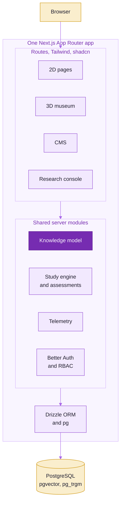

<picture>
  <source media="(prefers-color-scheme: dark)" srcset="../readme-kit/assets/divider-dark.svg">
  
</picture>

# &nbsp; ADR 0001: Stack and project foundation

- **Status:** accepted
- **Date:** 2026-10-14

## Context

Immersive Episteme needs two experimentally controlled learning conditions (2D pages and a
3D museum) that share one knowledge model, auth/RBAC, study engine, assessments, telemetry,
CMS and research console. The master directive fixes the broad stack and forbids
Mongo/Neo4j/Redis/Kafka/microservices. Research validity depends on both conditions running
on the same build, the same data and the same instrumentation.

## Decision

One Next.js App Router **modular monolith**, TypeScript strict, PostgreSQL as the single
store. All versions are pinned exactly in `package.json` (no `^`), resolved with `npm view`
on 2026-10-14.

| Area | Choice (version) | Why |
|---|---|---|
| Framework | Next.js 16.4.5, React 19.3.0 | Latest stable. RSC, route handlers and server actions keep both conditions in one deployable. |
| Rendering model | `cacheComponents: true`, `partialPrefetching: true` | create-next-app 16.4 defaults; the docs say the next major makes both mandatory. Request-time reads (session, cookies) must sit behind `<Suspense>`. |
| Language | TypeScript 5.9.3 (`strict`, `noUncheckedIndexedAccess`) | TS 7.0 (native port) is `latest` on npm, but create-next-app 16.4 still scaffolds `^5`. Stay on 5.9 until Next documents TS 7 support. |
| Styling | Tailwind CSS 4.3.3 via `@tailwindcss/postcss`, tw-animate-css 1.4.0 | PostCSS is the path documented in `next/dist/docs` and works for Turbopack and Vitest alike. |
| Components | shadcn 4.21.4 (`radix-nova` style), radix-ui 1.8.1, lucide-react 1.57.0 | Owned source on accessible Radix primitives. The registry imports `cn` from the `cn` package; imports are rewritten to `@/lib/utils` (clsx 2.1.1 + tailwind-merge 3.7.0) and `cn` is not a dependency. `form` is the classic react-hook-form wrapper (new-york-v4 registry; nova has none) plus the newer `field`. |
| Validation | Zod 4.6.7 | One schema language for env, API input, content import and assessments. |
| Client state | TanStack Query 5.104.2, Zustand 5.0.15 | Server cache and local UI/3D state kept separate. |
| Database | PostgreSQL 18.6 + pgvector 0.8.7 (`pgvector/pgvector:pg18`); extensions `pg_trgm`, `vector`, `pgcrypto` | One relational store holds the typed knowledge graph (adjacency tables), embeddings, trigram search and append-only telemetry. |
| ORM | drizzle-orm 0.45.4, drizzle-kit 0.31.11, pg 8.23.1 | SQL-first and typed; generated SQL migrations are reviewed in git and applied by a programmatic migrator. The 1.0 line is still RC. |
| Auth | better-auth 1.7.7 | Self-hosted, Drizzle adapter, sessions in our Postgres. RBAC is layered in `src/lib/permissions`. |
| Tests | Vitest 5.0.4 (Vite 8.3.4, @vitejs/plugin-react 6.1.2, jsdom 30.1.2), Testing Library, Playwright 1.64.0 | Two Vitest projects: `dom` (jsdom) and `node` (logic, server, DB integration against `episteme_test`). |
| Lint | ESLint 9.39.5 + eslint-config-next 16.4.5 | ESLint 10 exists, but create-next-app 16.4 pins `^9`. |
| Runtime | Node 24 (`.nvmrc`), npm 11 | Current LTS. |
| CI | GitHub Actions, actions pinned by commit SHA | Typecheck, lint, test (pgvector service container), build, then a Playwright smoke job. |

Both conditions and the staff tools are routes of the one deployable, over shared modules and
the one store:

### Local database

Docker Compose runs `pgvector/pgvector:pg18` on host port **5433** (avoids a native Postgres
on 5432) with the named volume `immersive-episteme-pgdata` mounted at `/var/lib/postgresql`
(Postgres 18 images keep `PGDATA` in a versioned subdirectory). An init script creates
`episteme_test` for integration tests. Extensions are enabled by migration
`0000_enable_extensions`, not by the init script, so every database follows one migration path.

### Design tokens

`src/app/globals.css` implements design-reuse catalogue §2.5 with three fixes: a complete
`.dark` mapping of every shadcn semantic token; a black/white double focus ring in
high-contrast mode (yellow is reserved for the guidance cue); and no `--faint #7d7368`
(4.12:1, fails AA). `tests/unit/contrast.test.ts` parses the CSS and asserts at least 4.5:1
for 13 text/surface pairs in the light, dark and high-contrast themes (lowest: light muted
text on the muted surface, 4.66:1). The theme defaults to light and does not follow the OS,
so both conditions render identically unless a participant opts in.

### Security headers

Adapted from virtual-walkthrough: HSTS, nosniff, strict referrer, `frame-ancestors 'self'`,
COOP same-origin, and `Permissions-Policy` with `camera=()` (no WebXR AR passthrough;
`xr-spatial-tracking` stays self-only). `/admin`, `/research` and `/cms` send
`X-Frame-Options: DENY` and `frame-ancestors 'none'`. A full script CSP with nonces is
deferred until auth and the 3D runtime exist.

## Consequences

- All foundation dependencies are installed; later work should not need concurrent `npm install`.
- Modules that import `server-only` cannot be loaded by `tsx` scripts. Scripts use
  `scripts/db/_shared.ts` and `src/lib/env.ts`, which is deliberately not `server-only`.
- `shadcn add` re-introduces `import { cn } from "cn"`; rewrite it to `@/lib/utils`.
- `npm audit` reports 9 advisories in dev tooling (esbuild via drizzle-kit's `@esbuild-kit`,
  braces). None ship to the browser. Revisit when drizzle-kit 1.0 is stable.
- 2026-11-05: `next` and `eslint-config-next` moved from 16.4.0 to 16.4.5, pinned exactly, for
  GHSA-673q-mjm6-r5xr and GHSA-2464-fhr4-w9xw (critical), GHSA-p3m5-59mp-jv5r (high), all
  patched in 16.4.1, and the seven moderate advisories of the November 2026 Next.js security
  release, patched in 16.4.5. From 16.4.5 route handler responses no longer carry
  `Content-Length`; the figure and media file routes stopped setting it (DR-097).
