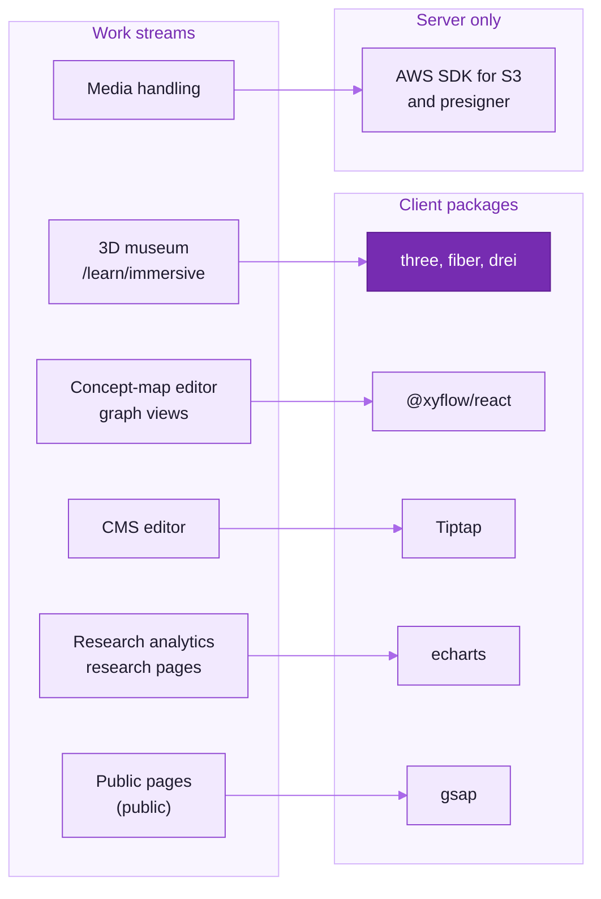

<picture>
  <source media="(prefers-color-scheme: dark)" srcset="../readme-kit/assets/divider-dark.svg">
  
</picture>

# &nbsp; ADR 0002: Feature dependencies for the later waves

- **Status:** accepted
- **Date:** 2026-10-14
- **Supersedes:** nothing; extends ADR 0001 (stack and foundation)

## Context

Seven work streams build on the wave-0 groundwork in parallel: the 2D condition, the 3D
museum, the concept-map / assessment UI, the CMS editor, research analytics, media handling
and the public pages. Concurrent `npm install` runs in one repository conflict on
`package-lock.json`, so every dependency those streams need is installed once, now, and pinned
exactly (no `^`), like ADR 0001.

## Decision

Versions resolved with `npm view <pkg> version` on 2026-10-14. Peer ranges checked with
`npm view <pkg>@<version> peerDependencies` against React 19.3.0, Next 16.4.0 and three 0.186.1.
`npm ls` reports no invalid, missing or unmet peer dependency.

| Package | Version | For | Why this one / peer check |
|---|---|---|---|
| `three` | 0.186.1 | 3D museum | Fixed by the project lead. |
| `@types/three` (dev) | 0.186.0 | 3D museum | Latest types; matches the three 0.186 API (types publish without a patch release). |
| `@react-three/fiber` | 9.8.1 | 3D museum | Peer `react >=19 <19.4`, `three >=0.156`: fits 19.3 / 0.186. |
| `@react-three/drei` | 10.7.9 | 3D museum | Peer `@react-three/fiber ^9`, `react ^19`, `three >=0.159`. |
| `@xyflow/react` | 12.12.0 | concept-map editor, graph views | Peer `react >=17`. Carries its own `zustand@4` (nested; the app's `zustand@5` is unaffected). |
| `@tiptap/core`, `@tiptap/pm`, `@tiptap/react`, `@tiptap/starter-kit` | 3.32.0 | CMS rich text (`concepts.body` is a Tiptap JSON doc) | `@tiptap/react` peers `@tiptap/core` and `@tiptap/pm` at exactly 3.32.0, so both are direct dependencies. |
| `@tiptap/extensions` | 3.32.0 | CMS | Tiptap 3 moved Placeholder and CharacterCount here; the two single-extension packages below are thin re-exports that peer on it. |
| `@tiptap/extension-link`, `-table`, `-image`, `-placeholder`, `-underline`, `-character-count` | 3.32.0 | CMS | As requested. In Tiptap 3 StarterKit already includes Link and Underline; the separate packages are kept so editors can configure them explicitly. |
| `echarts` | 6.1.0 | research analytics charts | Framework-free; import it in client components only. |
| `isomorphic-dompurify` | 4.5.0 | sanitising any HTML that reaches a page (RSC and client) | Wraps `dompurify` 3.4.x and uses `jsdom` on the server; its `jsdom@^30.1.2` dedupes with the test dependency `jsdom@30.1.2`. Server use: import from server code only, and add it to `serverExternalPackages` in next.config.ts if a server bundle ever fails to resolve jsdom. |
| `@aws-sdk/client-s3`, `@aws-sdk/s3-request-presigner` | 3.1151.0 | media object storage (`assets.storage_key`), presigned uploads/downloads | Same release line for both. Server only. |
| `gsap` | 3.15.0 | public pages only | Animation on the public site. Not in the learning conditions, so both conditions keep identical motion behaviour. |
| `fake-indexeddb` (dev) | 6.2.5 | tests of the telemetry outbox | IndexedDB in Node for Vitest. |

Which work stream each package serves, and where the bundle rule under Consequences confines it:



The diagram draws the decision as recorded. Since then `@react-three/fiber`, `@react-three/drei` and `gsap` have
left `package.json`: Door 2 drives `three` directly from `src/features/walkthrough`.

### Override

`@react-three/drei` → `stats-gl@2.4.2` declares `three@^0.170.0` as a regular dependency, which
installed a second three (0.170.0) under drei. Two copies of three break `instanceof` checks and
log "Multiple instances of Three.js". `package.json` overrides it:

```json
"overrides": { "stats-gl": { "three": "$three" } }
```

so the whole tree uses three 0.186.1 (`npm ls three` shows one version). stats-gl is only loaded
by drei's `<Stats>`/`<StatsGl>` helpers.

## Consequences

- `npm audit` lists 13 advisories (4 moderate, 9 high), all in tooling that predates this ADR (ADR 0001 counted 9 against an older advisory database):
  drizzle-kit (`@esbuild-kit` → esbuild), `eslint-config-next` / `shadcn` (`fast-glob` →
  `micromatch` → `braces`). None of the packages added here has an advisory.
- Bundle discipline is the importing stream's job: three/fiber/drei only under
  `/learn/immersive`; echarts only in research pages; gsap only in `(public)`; Tiptap only in
  the CMS. Use `next/dynamic` for client-only heavy modules.
- Upgrades follow ADR 0001: change the exact version, run `npm ls` and the full check.
