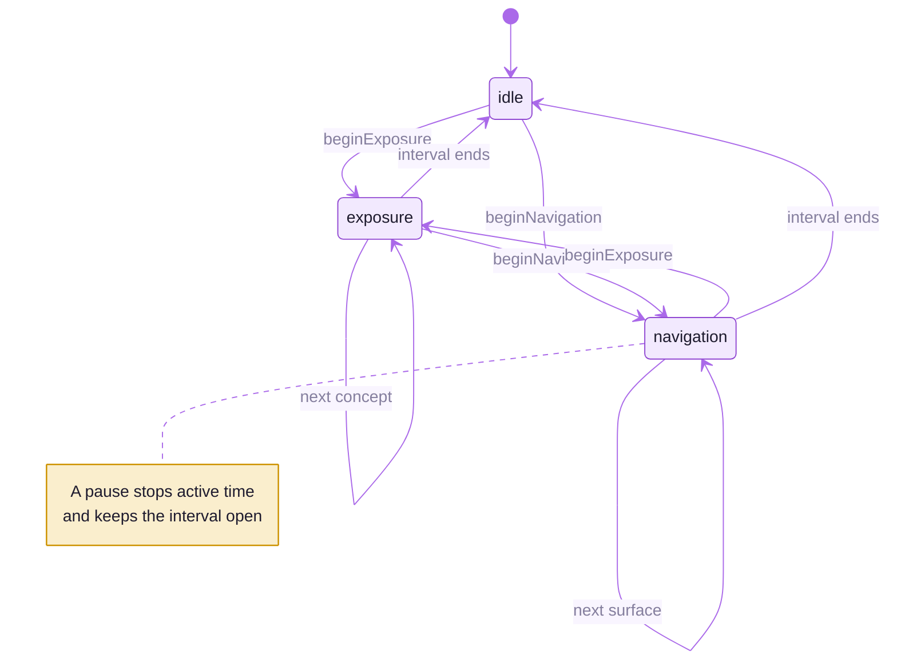

<picture>
  <source media="(prefers-color-scheme: dark)" srcset="../../../readme-kit/assets/divider-dark.svg">
  
</picture>

# &nbsp; Module record: condition equivalence (content, exposure time, citations)

Implements DR-015 (`../decisions.md`). Engineering reference:
`docs/architecture/data-and-telemetry-layer.md` §4c–4e. Every number below cites the file that
defines it or the test that checks it.

## Requirement

The lead required that the 2D and 3D conditions be "equivalent in content, exposure time and
citation availability (citations optional, never obstructing the primary learning path)", with
navigation kept distinct but "navigation time recorded separately from learning outcomes".
Navigation and spatial organisation are the manipulated variable; content, exposure and
citation access are controlled.

## Decisions

| # | Decision | Where | Alternatives considered |
|---|---|---|---|
| E1 | **Same content.** Both conditions read one immutable snapshot by id from the learning context; the 2D read model and the 3D manifest are built from the same payload. | `src/server/learning/context.ts`, `src/server/knowledge/read-model.ts` | Per-condition content stores (rejected: drift risk). |
| E2 | **Equal exposure by design.** Learning is self-paced under one cap (`config.exposure.minutes`), the same for every session of both conditions (DR-116). The server stamps the start on the first learning request and computes the end; the four learning timestamps and the stage-template hash are set once by trigger. A finish before the cap needs every stage visited. | `db/migrations/0026_learning_clock_template.sql`, `src/server/study/engine.ts` (`finishLearning`) | Client-side timers only (rejected: device clocks and reloads could stretch the budget); per-condition budgets (rejected: confound). |
| E3 | **Exposure and navigation measured identically.** One client time accountant shared by both conditions keeps exactly one open interval: content exposure, by ONE rule on the shared KnowledgeSheet (DR-050: the sheet is open, the 2D concept page or the 3D panel, and no navigation overlay covers it, wherever it is scrolled), or navigation (3D walking or the full Plan; 2D menus, catalogue, tradition and comparison lists, search, Contents or Search over a concept). Opening one closes the other at the same monotonic instant, so no moment counts twice. Time with neither is idle. | `src/features/telemetry/client/timing.ts`, `sheet-timing.ts` | Per-condition proxies such as page dwell vs room dwell (rejected: not comparable); overlapping intervals (rejected: double counting). |
| E4 | **Pauses excluded and logged.** Tab hidden, window blur and non-content modals pause the open interval; the pause is logged, and active time excludes it. Over a page load, elapsed = exposure + navigation + paused + idle exactly. | `timing.ts`; test `tests/unit/telemetry-client/timing.test.ts` ("reconciles exactly") | Ignoring hidden time (rejected: inflates exposure). |
| E5 | **No loss at page exit.** Events are queued synchronously; the exit handler first closes the open interval, then beacons the whole queue. | `tracker.ts`; test "closes the open interval on pagehide and sends it in the same exit beacon" | Async close after the flush (the reviewer found it could lose the last interval; fixed). |
| E6 | **Citations equally available, never obstructive.** One shared `CitationDisclosure` component for both conditions: collapsed by default, a native button (keyboard-operable), inline and non-modal, never pausing exposure. It shows title, author, publisher, year, locator, the verbatim quote (only when the claim cites exactly one source, so a quote is never attributed to the wrong source), and a readable label instead of an id. | `src/components/citations/citation-disclosure.tsx`; test `tests/unit/citation-disclosure.test.tsx` | Modal citation dialogs (rejected: block the learning path); hover-only tooltips (rejected: not keyboard/touch accessible). |
| E7 | **Timings stay out of outcomes.** Exposure, navigation, pause and citation data live in `telemetry_events` and versioned `derived_metrics` only. A database check refuses timing metric names in `derived_scores`, and a test asserts that no assessment or outcome table has a timing column. | `src/features/telemetry/metrics.ts`, `0009` (`derived_scores_no_timing_ck`), `tests/integration/learning-clock.test.ts` | Storing times next to scores (rejected: invites treating time as an outcome). |

The time accountant of E3 and E4 as the code runs now (`createTimeAccountant` in
`src/features/telemetry/client/timing.ts`): at most one interval is open, and opening one closes the
other at the same instant.

## What is measured

- Events: the 8 time and citation event types (`exposure_started/ended`,
  `navigation_started/ended`, `timing_paused/resumed`, `citation_opened/closed`) join the
  registry, making 33 types in all (`EVENT_TYPE_REGISTRY` in
  `src/features/telemetry/contracts.ts`; `event_types` count printed by `npm run dev:bootstrap`).
  Interval events can only be emitted by the time accountant (the public `track` refuses them,
  test "refuses interval events through the public track").
- Vocabularies: 4 exposure layers, 5 navigation surfaces and 3 pause causes
  (`EXPOSURE_LAYERS`, `NAVIGATION_SURFACES` and `PAUSE_CAUSES` in the contracts).
- Derived metrics v1, 6 definitions (`TIMING_METRIC_DEFINITIONS`): total exposure, exposure per
  layer, navigation, navigation share, pause, citation openings. Intervals without an end
  event are counted as unterminated and excluded, never estimated.
- Server: learning start, budget, scheduled end and actual end per session
  (`study_sessions.learning_*`).

## Implications for the paper

- Report exposure as **controlled by design** (same fixed budget, server-timed) and the
  measured exposure and navigation times per condition as **descriptive variables or
  covariates**, not outcomes.
- State the operational definitions above (what counts as exposure in each condition) and that
  paused time (hidden tab, blurred window, non-content modal) is excluded.
- Citation use is optional and measured in both conditions with the same component; report
  openings per condition as an exploratory measure.
- Limitation: client-measured intervals depend on the page's own declaration of when content is
  visible; unterminated intervals (crashed browsers) are excluded and reported.

## Open points for the researchers

- The learning budget in minutes is a study-protocol decision (Q-R9). The development demo
  study is self-paced; no number has been chosen in code.
- Whether "concept page in view" in 2D means the page is open, or each section scrolled into
  view, is a decision for the 2D wave. The accountant supports either via `useContentExposure`.
